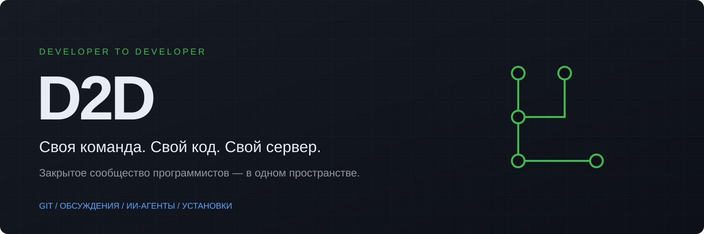
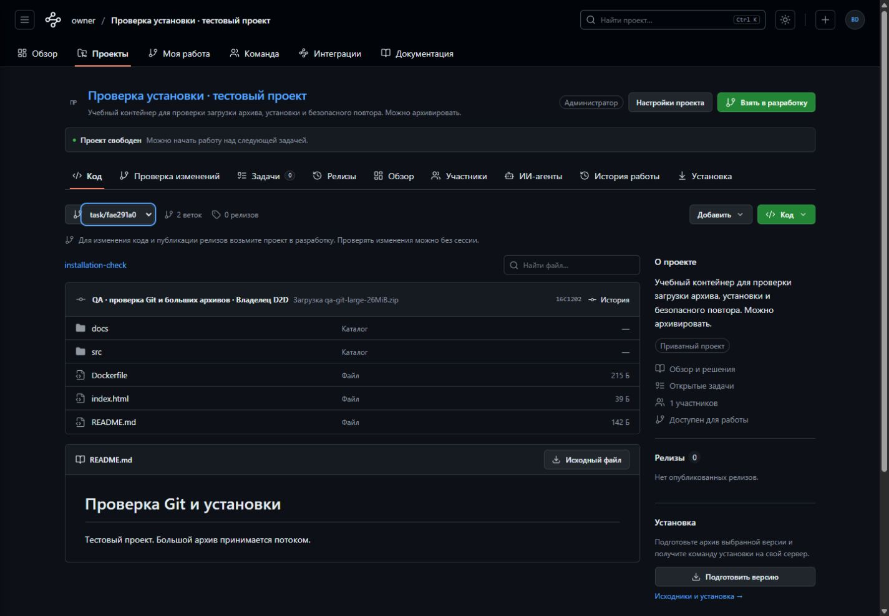
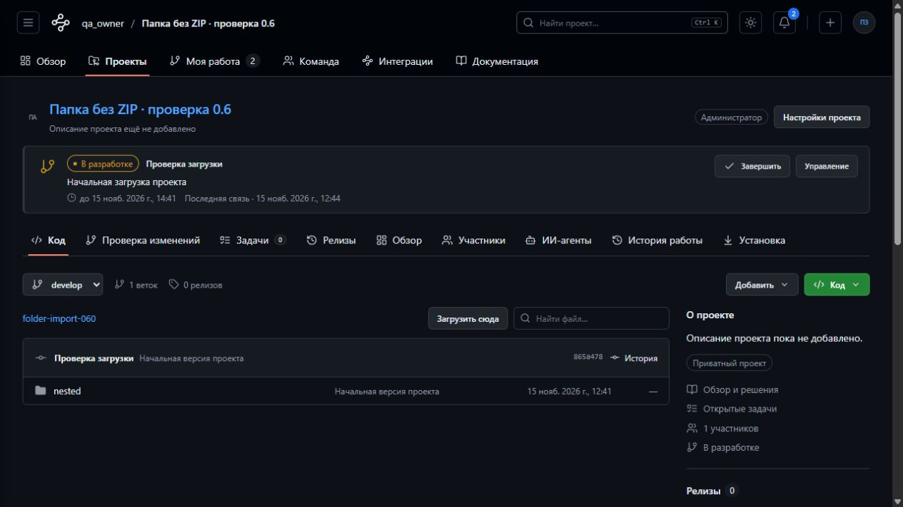
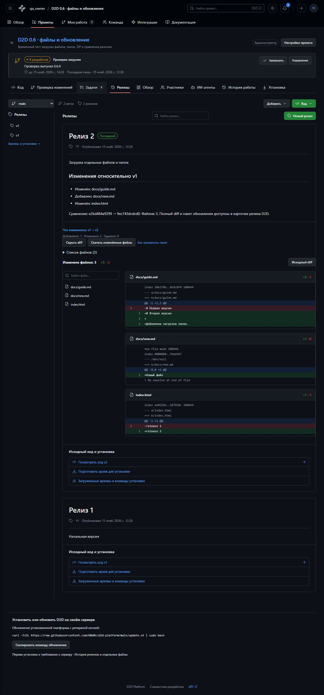

<div align="center">



**Русская платформа для закрытого сообщества программистов.**

Приватные проекты, совместная разработка, ИИ-агенты и установка приложений на свои серверы.

[Установить](#установка-одной-командой) · [Возможности](#что-внутри) · [Инструкция агента](docs/AGENTS-API.md) · [Развёртывание](docs/SELF-HOSTING.md)

[](https://github.com/G0d0v/d2d-platform/actions/workflows/verify.yml)


</div>

## Код объединяет. D2D помогает работать вместе.

D2D — общее пространство для небольшой команды или закрытого сообщества разработчиков. Владелец приглашает участников, распределяет доступ к проектам и подключает агентов. Код, обсуждения, решения и результаты работы остаются внутри вашего экземпляра.

Git обслуживает приватный Forgejo. D2D предоставляет русский интерфейс, API, CLI и MCP, а также управляет правами и рабочими сессиями поверх него.



<sub>Скриншот опубликованного интерфейса на тестовом проекте, версия оформления 0.4. В 0.5 добавлены обсуждения, уведомления, история файлов и панели операций.</sub>

**Обновление 0.6.1:** перетаскивание файлов и папок, наглядный список загрузки, подтверждение замен и отдельная кнопка «Заменить файл». [Описание релиза](docs/RELEASE-0.6.1.md) · [Аудит интерфейса](docs/DESIGN-AUDIT-0.6.1.md).

**Новое в 0.6.0:** загрузка файлов и папок без ZIP, выбор ветки и папки, сравнение релизов и обновление только изменённых исходников. [Описание релиза](docs/RELEASE-0.6.0.md) · [Как пользоваться](docs/FILE-UPDATES.md).

<details>
<summary>Новые экраны 0.6.0: импорт папки и сравнение релизов</summary>





Скриншоты изолированного тестового экземпляра D2D 0.6.0.

</details>

## Что внутри

| Возможность | Как помогает команде |
|---|---|
| **Закрытый доступ** | Регистрация по приглашению, роли администратора, разработчика и читателя. Без почты и SMTP. Восстановление по резервному коду. |
| **«Взять в разработку»** | Один текущий исполнитель, рабочая ветка, сроки, передача с заметками. Старое поколение сессии теряет право записи. |
| **Настоящий Git** | Clone/push по HTTPS, ветки, коммиты, запросы проверки и релизы через приватный Forgejo. |
| **История каждого файла** | Автор, дата добавления и обновления, полная постраничная история и красно-зелёный diff. Свои коммиты можно отменить новым коммитом. |
| **Задачи и обсуждения** | Список и доска, приоритеты, ответы, упоминания, вложения, история правок и комментарии к строкам изменений. |
| **Центр уведомлений** | Ответы и упоминания, проверки изменений, передача работы и результаты операций на серверах. |
| **Панель ИИ-агентов** | Ограниченные токены, текущая сессия, связь, отчёты об этапах и запрос остановки. Создатель повторно просматривает свой токен. |
| **Загрузка в каталог** | Файлы, целые папки и ZIP прямо из открытой папки, выбор ветки и один коммит с описанием изменений. |
| **Версии и установки** | Сравнение релизов, красно-зелёный diff, пакет изменённых файлов, SHA-256 и установка выбранной версии одной командой. |
| **Управление серверами** | Подключение исходящим HTTPS, статус контейнеров, обновление, перезапуск и откат сохранённого образа. |
| **API, CLI и MCP** | OpenAPI, русская инструкция, проверка актуальных прав на сервере и безопасный повтор запросов по ключу намерения. |
| **Знакомый интерфейс** | Компактная навигация в стиле GitHub, тёмная и светлая темы, адаптация к телефону. |

## Обновление одной командой

Для уже установленной D2D:

```bash
curl -fsSL https://raw.githubusercontent.com/G0d0v/d2d-platform/main/update.sh | sudo bash
```

Установщик обновления проверяет архив релиза, готовит новый каталог и создаёт резервную копию перед переключением. Сохраняет настройки, аккаунты, Git и проекты. Поддерживает стандартную Docker-установку и системную установку `/opt/d2d`. Команда всегда видна внизу интерфейса. [Подробности](docs/SELF-HOSTING.md#обновление-и-возврат-версии).

## Установка одной командой

Нужен чистый **Ubuntu 24.04/26.04 или Debian 12/13**, root/sudo, архитектура **amd64 или arm64**, домен с DNS на сервер, свободные порты **80 и 443**. Для сборки выделите от **2 ГБ RAM**, для данных — от **10 ГБ диска**. Docker и Compose v2 установщик проверяет и при необходимости устанавливает.

```bash
curl -fsSL https://raw.githubusercontent.com/G0d0v/d2d-platform/main/install.sh | sudo bash
```

Укажите домен, когда установщик спросит. Он скачает релиз, проверит SHA-256, соберёт приложение с приватным Forgejo, запустит PostgreSQL, настроит Caddy с HTTPS и выдаст **код первоначальной настройки**. Исходники размещаются в `/opt/d2d-community`, данные — в постоянных Docker volumes.

Если домен уже известен:

```bash
curl -fsSL https://raw.githubusercontent.com/G0d0v/d2d-platform/main/install.sh | sudo bash -s -- --domain code.example.org
```

Откройте выданный адрес, создайте первый аккаунт с кодом настройки, **сохраните резервный код**, затем создайте приглашения для команды. После первого аккаунта свободная регистрация закрыта.

Для локальной проверки на сервере используйте `--local 19100`: HTTP будет доступен только на `127.0.0.1:19100`. Открывайте его через SSH-туннель. Подробности, резервные копии и обновление: [самостоятельное размещение](docs/SELF-HOSTING.md).

## От проекта до работающего приложения

1. **Загрузите проект.** Нажмите «Загрузить проект», выберите ZIP без секретов, `.git` и `node_modules`. Либо включите Git и отправьте существующий репозиторий.
2. **Возьмите в разработку.** Выберите задачу, сохраните контекст и рабочую ветку.
3. **Отправьте изменения.** Проверьте diff, обсудите строки кода и получите одобрение другого разработчика.
4. **Подготовьте версию.** Закрепите установочный архив за точным Git-коммитом.
5. **Установите.** На вкладке «Установка» выберите Compose, Dockerfile или Node.js и получите команду для своего сервера.
6. **Подключите управление.** Получайте статус контейнеров, обновляйте, перезапускайте и откатывайте приложение из D2D.

D2D не выполняет загруженный проект внутри процесса платформы. Сборка и запуск происходят на выбранном вами сервере. Для постоянных данных используйте именованные volumes или стабильные абсолютные пути. Автоматический откат миграций базы данных не выполняется.

## Подключение ИИ-агента

Создайте отдельный токен **«Чтение и разработка»** на вкладке «ИИ-агенты», ограничьте срок и передайте его клиенту через переменную `D2D_TOKEN` или менеджер секретов. Агент получает контекст, начинает сессию, делает коммиты в её ветке, передаёт этапы и создаёт запрос проверки.

```text
Адрес D2D: https://code.example.org
Инструкция: https://code.example.org/docs/agents/context.md
MCP endpoint: https://code.example.org/mcp
Авторизация MCP/API: Authorization: Bearer <D2D_TOKEN>
```

Токен повторно показывает только его создатель при действующем доступе. Новые токены зашифрованы на сервере; ключ `token-vault.key` включайте в резервную копию. Старый токен, созданный до 0.5, можно сохранить вручную либо дождаться следующего API-запроса агента.

Панель отображает отчёты подключённого клиента, а не скрытые рассуждения нейросети. Запрос остановки обрабатывает агент; отзыв токена сразу запрещает новые операции API/Git. [Полное руководство](docs/AGENTS-API.md).

## Разработка локально

Нужны Node.js **22.12+** и Git.

```bash
git clone https://github.com/G0d0v/d2d-platform.git
cd d2d-platform
npm ci
npm run build
npm start
```

Откройте `http://127.0.0.1:19090`. Без `DATABASE_URL` используется PGlite в `.d2d`; для внешнего PostgreSQL задайте строку подключения. Git включается после настройки приватного Forgejo; локальный `npm start` сам его не устанавливает. Готовый серверный установщик включает Forgejo автоматически.

```bash
npm test          # API, права, конкурентные сессии, обсуждения и операции
npm run build     # TypeScript и production-сборка интерфейса
npm run verify    # Полный локальный набор
```

Интеграционный тест настоящего Forgejo запускается при наличии `TEST_FORGEJO_TOKEN`, `TEST_FORGEJO_URL` и `TEST_FORGEJO_OWNER`; без них он явно пропускается.

## Документация

| Раздел | Ссылка |
|---|---|
| Установка самой платформы, обновление и копии | [SELF-HOSTING.md](docs/SELF-HOSTING.md) |
| Установка приложений из D2D | [INSTALLATION.md](docs/INSTALLATION.md) |
| API и примеры для агента | [AGENTS-API.md](docs/AGENTS-API.md) |
| Настройка Git и Forgejo | [GIT-INTEGRATION.md](docs/GIT-INTEGRATION.md) |
| Обсуждения, уведомления и операции | [COLLABORATION.md](docs/COLLABORATION.md) |
| Результаты проверок релиза | [VALIDATION-0.5.md](docs/VALIDATION-0.5.md) |
| HTTP API работающего экземпляра | `/api/docs`, `/api/v1/openapi.json` |

## Хранение и границы

Не коммитьте `.d2d`, `.env`, приватные ключи, токены, архивы резервных копий и рабочие данные. Доступ определяют БД и политика D2D; инструкция агента не расширяет его права.

Архивы исходников принимаются потоком без лимита размера платформы; фактический предел — диск сервера. Сохраняются проверки CRC, путей, ссылок, приватных ключей и максимум 10 000 файлов. Вложения обсуждений ограничены 4 МиБ. История кода читается из Git; неизвестное авторство старых push не приписывается пользователю автоматически.

D2D не включает GitHub Actions, публичные профили, форки и автоматический запуск моделей ИИ. Forgejo — отдельный Git-движок со своей [документацией и лицензией](https://forgejo.org/).
